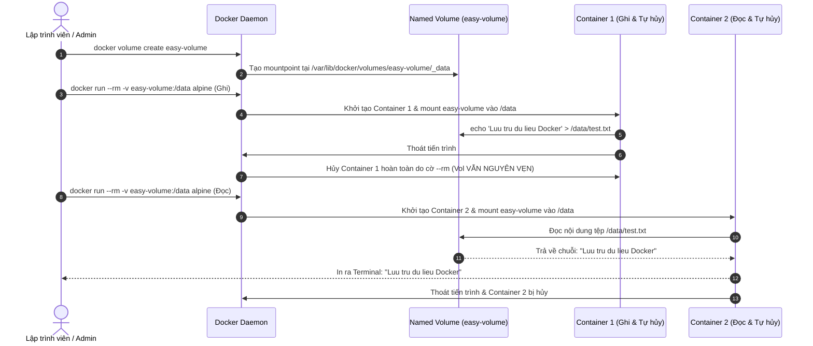

# Báo cáo Bài tập 4: Lưu trữ dữ liệu đơn giản với Docker Volume

- **Họ và tên:** Phạm Thanh Phong
- **Mã sinh viên:** N24DTCN120
- **Môn học:** IT209
- **Session:** 09
- **Bài tập:** 04 (BT4)
- **Tệp nộp bài:** [README.md](./README.md)
- **Đường dẫn trên GitHub:** `homework/session_09/ex4/`

---

## 1. Bối cảnh & Mục tiêu bài tập

### 1.1. Bối cảnh lưu trữ trong Container
Container vốn được thiết kế theo nguyên lý **Stateless & Ephemeral** (tạm thời, không lưu trạng thái). Mỗi container sở hữu một writable layer (tầng ghi dữ liệu tạm). Khi container bị dừng và xóa bỏ (`docker rm` hoặc cờ `--rm`), toàn bộ dữ liệu sinh ra bên trong writable layer này sẽ vĩnh viễn biến mất.

Để giải quyết bài toán dữ liệu bền vững (Stateful applications như Database, Log storage, File uploads), Docker cung cấp cơ chế **Volumes**:
- Được quản lý trực tiếp bởi Docker Daemon tại đường dẫn hệ thống máy chủ (`/var/lib/docker/volumes/<volume-name>/_data`).
- Hoàn toàn tách biệt khỏi vòng đời của Container.
- Nhiều container có thể gắn kết (mount) đồng thời vào cùng một Volume để chia sẻ dữ liệu.

### 1.2. Yêu cầu & Ràng buộc
1. Khởi tạo một Named Volume mang tên `easy-volume`.
2. Sử dụng container Alpine 1 ghi chuỗi `"Luu tru du lieu Docker"` vào tệp `/data/test.txt` thông qua mount volume (`-v easy-volume:/data`).
3. Sử dụng container Alpine 2 hoàn toàn độc lập để mount lại volume và đọc nội dung tệp tin bằng lệnh `cat /data/test.txt`.
4. Xác nhận kết quả mong đợi: Dòng chữ `"Luu tru du lieu Docker"` được in ra nguyên vẹn.

---

## 2. Kiến trúc Docker Named Volume & Vòng đời Dữ liệu



---

## 3. So sánh các hình thức lưu trữ trong Docker

| Đặc tính | Container Writable Layer | Bind Mount | Docker Named Volume |
| :--- | :--- | :--- | :--- |
| **Vị trí lưu trữ** | Gắn chặt với container | Bất kỳ thư mục nào trên Host (vd: `/home/user/app`) | Quản lý tập trung bởi Docker (`/var/lib/docker/volumes`) |
| **Tính bền vững** | Bị xóa khi container bị xóa | Bền vững trên Host | **Bền vững độc lập với container** |
| **Quản lý qua CLI** | `docker diff`, `docker commit` | Không có lệnh quản lý riêng | **`docker volume (create/ls/inspect/rm)`** |
| **Khả năng chia sẻ** | Khó chia sẻ | Dễ chia sẻ | **Tối ưu chia sẻ an toàn giữa các container** |
| **Hiệu năng I/O** | Chậm (qua storage driver) | Nhanh (Native Host I/O) | **Tối ưu tối đa trên Linux I/O** |

---

## 4. Nhật ký thực thi chi tiết & Phân tích lệnh CLI

### Bước 1: Khởi tạo và kiểm tra Named Volume
```bash
docker volume create easy-volume
```
- **Kết quả:**
```plaintext
easy-volume
```
- **Kiểm tra danh sách và thông số mount:**
```bash
docker volume ls
docker volume inspect easy-volume
```
- **Thông tin chi tiết:**
```json
[
    {
        "CreatedAt": "2026-10-13T09:09:15+07:00",
        "Driver": "local",
        "Labels": null,
        "Mountpoint": "/var/lib/docker/volumes/easy-volume/_data",
        "Name": "easy-volume",
        "Options": null,
        "Scope": "local"
    }
]
```

---

### Bước 2: Ghi dữ liệu từ Container 1
```bash
docker run --rm -v easy-volume:/data alpine sh -c "echo 'Luu tru du lieu Docker' > /data/test.txt"
```
- **Phân tích tham số:**
  - `--rm`: Tự động dọn dẹp và xóa container ngay khi tiến trình kết thúc.
  - `-v easy-volume:/data`: Gắn kết volume `easy-volume` vào đường dẫn `/data` bên trong container.
  - `sh -c "echo 'Luu tru du lieu Docker' > /data/test.txt"`: Thực thi lệnh ghi dữ liệu vào tệp `test.txt` bên trong volume.

---

### Bước 3: Đọc dữ liệu từ Container 2 (Kiểm chứng tính toàn vẹn)
```bash
docker run --rm -v easy-volume:/data alpine cat /data/test.txt
```
- **Kết quả đầu ra Terminal:**
```plaintext
Luu tru du lieu Docker
```
- **Đánh giá:**
  Container 1 đã hoàn toàn biến mất khỏi danh sách tiến trình máy tính, tuy nhiên khi container 2 khởi chạy và gắn kết cùng một Volume, tệp tin `test.txt` vẫn tồn tại nguyên vẹn 100%.

---

### Bước 4: Vòng đời dọn dẹp Volume
```bash
docker volume rm easy-volume
```
- **Kết quả:**
```plaintext
easy-volume
```

---

## 5. Bảng đối chiếu kết quả kiểm thử

| Tiêu chí kiểm tra | Yêu cầu | Kết quả thực tế | Đánh giá |
| :--- | :--- | :--- | :---: |
| **Khởi tạo Named Volume** | Tên volume `easy-volume` | Volume được tạo với driver `local` | **ĐẠT** |
| **Kiểm tra danh sách** | `docker volume ls` | Có `easy-volume` trong danh sách | **ĐẠT** |
| **Ghi dữ liệu (Container 1)** | Ghi chuỗi vào `/data/test.txt` | Ghi thành công, container tự hủy | **ĐẠT** |
| **Đọc dữ liệu (Container 2)** | In nội dung tệp bằng `cat` | Terminal in ra: `"Luu tru du lieu Docker"` | **ĐẠT** |
| **Bền vững dữ liệu** | Dữ liệu không mất khi container dừng | Dữ liệu được bảo toàn nguyên vẹn | **ĐẠT** |

---

## 6. Kết luận & Bài học kinh nghiệm
- Đã nắm vững bản chất hoạt động của Docker Named Volume trong việc phân tách dữ liệu ứng dụng khỏi vòng đời ngắn hạn của container.
- Hiểu rõ cờ `--rm` dùng cho các container chạy tác vụ tạm thời (one-off tasks) mà không để lại rác container tồn đọng trong hệ thống.
- Toàn bộ các câu lệnh đã thực thi được lưu trữ tường minh tại tệp nộp bài [README.md](./README.md).
